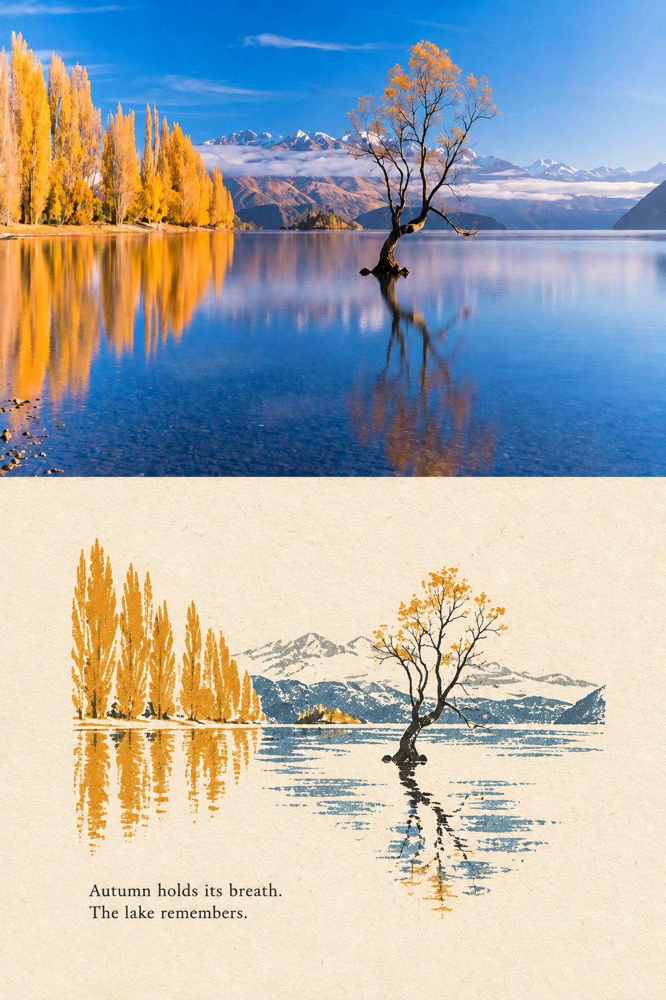

# Rubber-Stamp-Photo-Poster-Airy
将照片制作成上下对照海报，上半保留原照，下半转化为复古橡皮章版画，搭配象牙白纸底、斑驳油墨质感和简短英文诗句，保留舒适留白。 English: Creates a photo-and-print comparison poster, preserving the original photo above and reinterpreting it as a vintage rubber-stamp illustration below, with ivory paper, distressed ink textures, a short English poem.

## 使用 / Usage

将本仓库内容放入 Codex 个人技能目录下的 `artifact-template-rubber-stamp-photo-poster-airy` 文件夹，然后上传照片并调用：

Place this repository in your Codex personal skills directory as `artifact-template-rubber-stamp-photo-poster-airy`, then upload a photo and invoke:

```text
$artifact-template-rubber-stamp-photo-poster-airy
```

需要可用的 ImageGen 图像生成能力。上半保留本次原照，下半采用参考图中已确认的 90% 设计比例；直接匹配该比例，不再重复缩小。

Requires ImageGen. Preserve the supplied photo above and match the approved 90% design scale below, without applying another reduction.

## 预览 / Preview


